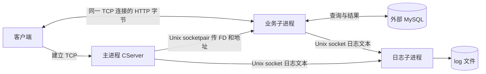
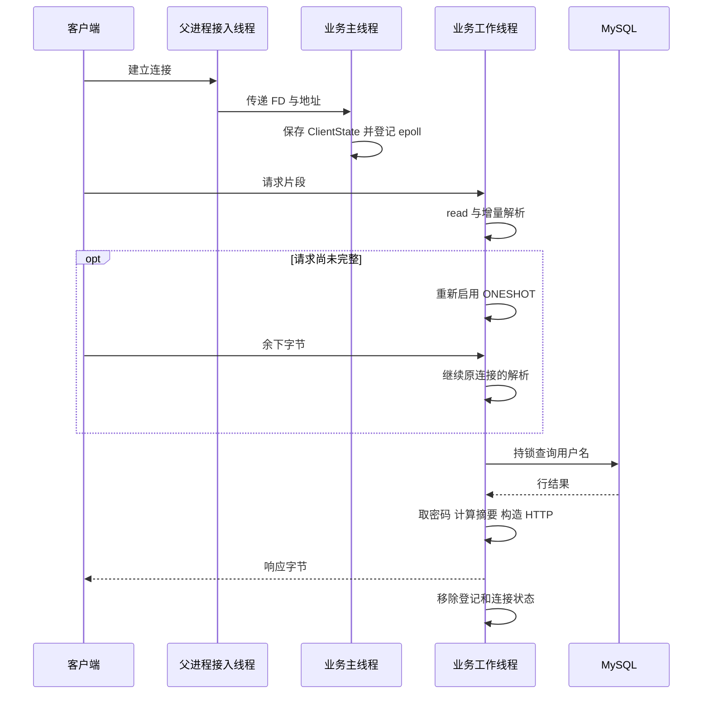

# EPlayerServer 阶段零 项目架构与请求主线

本章先建立一个稳定画面：连接在哪里接入、请求在哪里处理、结果从哪里返回。细节暂时只解释到能追踪一次登录的程度；后续章节再拆开每个接口。

源码入口：[main.cpp](../src/main.cpp)、[CServer.h](../inc/CServer.h)、[CServer.cpp](../src/CServer.cpp)、[EdoyunPlayerServer.h](../inc/EdoyunPlayerServer.h)、[业务实现](../src/EdoyunPlayerServer.cpp)。

## 1. 一个程序里的三个组织层次

### 1.1 文件和模块描述职责

```text
main.cpp                          装配入口和正常退出协调
CServer / CBusiness               连接接入与可替换业务入口
CProcess                         fork、控制通道、描述符转交
CSocket / CEpoll                  字节收发和就绪事件
CThread / CThreadPool / CFunction  执行线程和可保存调用
LogInfo / CLoggerServer           记录构造、传输与落盘
CHttpParser / UrlParser           HTTP 语法与 URL 参数
CDatabaseClient / Table / Field   执行接口、SQL 元数据与行映射
CEdoyunPlayerServer / Crypto      登录规则与摘要
```

一个模块可以在多个进程中被使用。例如 CSocket 同时服务于 TCP 接入、业务收发和日志 IPC，不能把它对应为某一个唯一进程。

### 1.2 进程描述地址空间

主进程、业务子进程、日志子进程使用同一个可执行文件中的代码，却各有独立的普通内存。父进程中的业务对象与 fork 后的业务对象副本不是跨进程共享对象。

MySQL 则是应用外部的数据库服务。它没有被 main 的两次 fork 创建。

### 1.3 线程描述执行者

同一进程中的线程共享普通内存和描述符表，因此能够访问同一个连接状态表，也因此必须处理数据竞争。进程隔离和线程互斥各自解决不同问题。

阅读时把“对象存在于哪个地址空间”和“哪条线程正在调用它”分开。例如业务子进程主线程创建 ClientState，稍后业务工作线程取得它并读取请求。

后文用 FD（文件描述符）表示进程访问打开资源的整数编号，socket 是通信端点；同一个 TCP 连接可以由不同进程中的 FD 引用。IPC 是进程间通信的统称，本项目通过 Unix socket 在本机进程之间传消息。

epoll 保存关注的 FD 集合，等待可读等就绪条件；事件循环反复执行“等待、取出事件、处理”。这里“可读”表示可以尝试读取，完整 HTTP 请求仍可能需要多次读取才能收齐。

## 2. 运行架构



父进程 accept 后，把访问已连接 socket 的描述符交给业务子进程。随后 HTTP 数据直接由业务进程收发，父进程不逐段转发 HTTP，也不会重新为客户端建立第二条 TCP 连接。

应用有两种本地通信：父子控制用的 SOCK_SEQPACKET socketpair 保留消息边界；日志使用 Unix SOCK_STREAM 传文本，不保留记录边界。它们都属于 Unix socket，但协议用途和语义不同。

## 3. 各进程里实际运行哪些线程

| 进程 | 主执行线程 | 其他显式创建线程 |
| --- | --- | --- |
| 父进程 | main 中的初始化、Run 和 Close | CThreadPool 创建 2 个接入工作线程 |
| 业务子进程 | BusinessProcess 初始化并循环 RecvSocket | CThreadPool 创建 N 个业务工作线程 |
| 日志子进程 | LogProcess 等待停止消息 | 一个 CThread 执行日志事件循环 |

默认 N 为 4。只统计本项目显式组织的线程，父进程 3 条、业务进程 `1 + N` 条、日志进程 2 条，共 `N + 6` 条，默认 10 条；不包含外部数据库线程。

这里没有“连接来一条就创建一个线程”。父进程的两个线程共享一个监听 epoll，业务 N 个线程共享另一个客户端 epoll，日志线程拥有自己的日志 epoll。

## 4. 装配顺序与 fork 的分界

main 的正常路径为：

```text
解析 host、port、workers
  → 创建日志 CProcess 并 fork
  → 等日志就绪
  → 构造 business 和 server
  → server.Init 绑定业务入口并 fork
  → 等业务就绪
  → 创建父进程监听、epoll、接入线程
  → 安装停止信号处理
  → server.Run
```

第二次 fork 时，父进程还没有启动接入线程，business 还没有数据库连接和业务工作线程。子进程进入 BusinessProcess 后才创建这些资源。

就绪通知只传一个整数结果。子进程成功初始化数据库，并不会让父进程中 business 的 m_db 自动变为有效；两份普通对象状态已经分开。

## 5. 最短登录链按位置拆解

### 5.1 父进程只完成接入与转交

CServer::ThreadFunc 的正常路径可以先按下面的顺序理解，完整实现见 [CServer.cpp](../src/CServer.cpp)：

```text
WaitEvents 等监听就绪
  → 检查 EPOLLIN，即可读事件
  → Link 内部 accept，得到客户端包装
  → SendSocket 向业务进程传 FD 和地址
  → delete 父进程的客户端包装
  → 继续等待下一批事件
```

| 调用 | 输入 | 得到的结果 |
| --- | --- | --- |
| WaitEvents | 监听 epoll | 本轮有效事件数 |
| Link(&client) | 监听 socket 与输出指针地址 | accept 得到的新连接包装 |
| SendSocket(*client, *client) | FD 与客户端地址 | 将引用和地址放进本地消息 |
| delete client | 父进程的包装对象 | 关闭父进程持有的连接引用 |

两处 `*client` 先解引用成对象，再根据形参类型转换为整数 FD 与地址指针。父进程并没有把整个 C++ 对象复制到消息里。

删除父进程的包装会关闭父进程的 FD；转交成功的消息已保留内核引用，业务进程仍能接收并使用该连接。具体引用时间线在阶段二展开。

### 5.2 业务主线程登记连接

业务主线程收到 FD 后构造 ClientState，并配置 socket 非阻塞：

```text
RecvSocket
  → 建立 ClientState
  → socket.reset(new CSocket(fd))
  → Init 配置地址和非阻塞
  → 持 map 锁插入状态
  → 调用 Connected 回调
  → epoll.Add(IN | RDHUP | ONESHOT)
```

Connected 用于记录来源地址，此时在业务主线程执行。不是父进程 CServer 调用它。

### 5.3 业务工作线程收齐请求

工作线程根据事件中的 FD 查 map，复制一份 shared_ptr，再离开 map 锁。每次读取最多使用 8192 字节缓冲，实际读到的片段追加到 request 并送入同一个 parser。

业务使用 ONESHOT：交付一次事件后暂时停用该连接的事件登记，处理线程完成本轮状态更新，再决定重新启用还是移除。它帮助多条工作线程先后处理同一连接。

不完整时重新启用；完整时调用 Received；错误或累计超限时移除。parser 与 request 归连接所有，能跨多个事件保留。

### 5.4 Received 同步完成登录和响应

Received 是请求完整后调用的回调，即事先登记、到指定条件满足时执行的函数。它在当前工作线程内完成下面这条调用链，源码在阶段九展开：

```text
完整请求 → HttpParser 得到业务状态 → MakeResponse 生成响应 → client->Send
```

这些调用依次完成，没有在这里启动新线程或再投递一个登录任务。

HttpParser 检查方法、路径和参数，锁住唯一 MySQL 连接完成转义查询，读取密码后计算 MD5。MakeResponse 把 int 状态转换成 JSON，再补 HTTP 头。

## 6. 一次请求的线程时序



图中 W 表示当前处理线程，不表示某条连接固定绑定这个线程。前后两段请求可能由不同工作线程先后处理，ONESHOT 与连接状态保证本轮处理的组织顺序。

## 7. 对象持有关系

```text
main
  ├─ logProcess：管理日志子进程和控制通道
  ├─ business：父进程中的对象；fork 后子进程有独立副本
  └─ server
       ├─ m_business：借用 business，不负责 delete
       ├─ m_process：管理业务子进程
       ├─ m_server：拥有监听包装对象
       ├─ m_epoll：拥有父进程 epoll FD
       └─ m_pool：拥有接入工作线程

业务子进程中的 business
  ├─ m_db：unique_ptr 持有 MySQL 客户端
  ├─ m_mapClients：map 持有连接状态 shared_ptr
  │    └─ ClientState：socket、parser、request
  ├─ m_epoll：业务 epoll
  └─ m_pool：业务工作线程
```

“持有”需要结合具体类型理解。map 和工作线程可共同持有 ClientState；shared_ptr 保证对象活着，但不自动保护其成员。CServer 对 business 是借用关联，不是独占所有权。

业务入口正常停止会显式关闭数据库和线程。入口返回后 CProcess 用 _exit 结束子进程，外层 business 不会沿 main 的栈自动析构；这一点在阶段十详细解释。

## 8. 沿主线看数据怎样变形

| 交接点 | 交给下一步的数据 | 接收者负责什么 |
| --- | --- | --- |
| 父进程 → 业务主线程 | FD 与客户端地址 | 建立连接状态和事件登记 |
| socket → 增量解析器 | 本次实际读到的字节片段 | 持续更新 HTTP 语法进度 |
| 完整请求 → Received | 累计的原始请求 Buffer | 调用业务校验 |
| URL → 查询 | 解码后的 user | 转义并生成用户名条件 |
| 查询 → 规则 | 独立行对象中的密码字符串 | 与 time、key、salt 拼接计算 MD5 |
| 规则 → 响应构造 | int 业务状态 | 生成 JSON 和 HTTP 字节 |
| 响应 → socket | 完整响应 Buffer | 尝试将字节交给内核 |

数据每次交接都改变了下一层需要认识的内容。登录通过时业务状态为 0；HTTP 起始行当前固定为 200，即使用户不存在也会返回 200 和 JSON status=-4。两层结果应分别读取。

## 9. 从架构观察设计模式

本阶段只定位，不展开全部定义：epoll 与事件循环体现 Reactor；CFunction 把调用封装成对象，供线程池保存和执行；数据库客户端适配不同 C API；table.Copy 克隆独立结果行；CServer 通过 CBusiness 替换整个业务入口。

这些机制在不同尺度上协作。进程隔离不等于接口隔离，回调不自动构成观察者模式，析构也不保证所有进程退出方式都执行 RAII。

## 10. 本章源码定位与后续关系

| 文件 | 首先关注的入口 | 带入下一章的认识 |
| --- | --- | --- |
| main.cpp | main、LogProcess | 入口选择具体对象，组织启动与关闭 |
| CServer.cpp | Init、ThreadFunc、Close | 接入层不包含登录算法 |
| EdoyunPlayerServer.cpp | BusinessProcess、ThreadFunc、Received | 业务进程自己组织客户端事件与回调 |
| EdoyunPlayerServer.h | ClientState 与成员字段 | 状态持久性、共享与所有权有明确落点 |

[返回路线](README.md) · [下一章 C++ 对象与构建基础](01-C++对象与构建基础.md)
