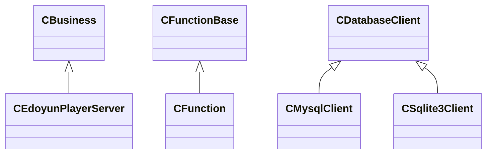

# EPlayerServer 阶段一 C++ 对象与构建基础

本章连接“类的声明”和“运行中的对象”：理解指针、虚调用、复制、生命周期和构建目标之后，才能准确读懂后续的进程入口、任务队列和结果克隆。

源码入口：[Public.h](../inc/Public.h)、[Function.h](../inc/Function.h)、[CServer.h](../inc/CServer.h)、[DatabaseHelper.h](../inc/DatabaseHelper.h)、[CMakeLists.txt](../CMakeLists.txt)。

## 1. 一个表达式涉及哪些对象

先看实际的连接转交：

```cpp
CSocketBase* client = nullptr;
m_server->Link(&client);
m_process.SendSocket(*client, *client);
delete client;
```

这是从接入逻辑抽出的片段，省略了失败分支。里面至少有四个不同实体：指针变量 client、它指向的 CSocket 对象、对象内部的 FD 整数、FD 引用的内核 socket。

| 实体 | 位于哪里 | 结束方式 |
| --- | --- | --- |
| client 指针变量 | 当前调用栈 | 离开作用域 |
| new 创建的 CSocket | 当前进程堆 | delete 或拥有它的智能指针释放 |
| FD 表项 | 当前进程描述符表 | close |
| 内核 socket | 内核 | 相关引用和协议状态允许时回收 |

指针变量消失不等于 delete，delete 包装对象触发 close，也不等于别的进程不再引用同一个连接。后续讲义会反复使用这组区分。

## 2. 引用、const 与输出参数

### 2.1 Buffer const& 的含义

`Send(Buffer const& data)` 借用现有 Buffer，不复制整个字符串，并通过这个引用限制修改。它没有表示“把 data 所有权转给 Send”，也没有表示另一个线程不能同时访问底层对象。

`char const*` 表示不能通过此指针写字符；`char* const` 则表示指针变量本身不能重新指向别处。const 所在的位置决定受限制的对象。

### 2.2 Link 为什么接受二级指针

调用方传 `&client`，函数得到的是“调用方指针变量的地址”。函数内部执行 `*pClient = new CSocket(fd)`，就能把新对象地址写回 client。

若参数只是 `CSocketBase* pClient`，赋值改变的是函数自己的指针副本，外面的 client 不会被更新。二级指针解决输出方式，最终所有权仍需由接口约定和代码确认。

### 2.3 两次 *client 为什么类型不同

`*client` 先得到 CSocketBase 对象引用，形参再决定转换：

| SendSocket 形参 | 采用的对象能力 | 结果 |
| --- | --- | --- |
| int descriptor | operator int() | m_socket 的整数值 |
| sockaddr_in const* address | 地址转换运算符 | 对象保存的客户端地址 |

这是用户自定义转换。隐式写法简短，代价是读者必须结合形参类型判断行为；它不是复制两个 socket 对象。

## 3. Buffer 的长度与内存

Buffer 继承 std::string，增加长度构造和若干指针转换。核心构造的语义是：

```cpp
Buffer(size_t size) : std::string(size, '\0') {}
Buffer(char const* value, size_t size) : std::string(value, size) {}
```

第一种创建 size 个零字节，第二种复制显式范围。`Buffer(8192)` 已有 8192 个有效存储位置；`reserve(8192)` 只增加容量，不能等价地将 `[0,8192)` 当成已有字符访问。

假设 read 返回 37，Recv 会把长度改成 37。后续 request += chunk 只追加真实字节，而不是把余下 8155 个零也当作请求。

### 3.1 size、capacity 和终止零

| 概念 | 例子 | 用途 |
| --- | --- | --- |
| size | 字符串中逻辑字节数量 | 网络长度、HTTP Content-Length |
| capacity | 当前分配可容纳的字符数量 | 降低重新分配次数 |
| 终止零 | C 字符串末尾的 '\0' | 兼容以零结尾的 C 接口 |

字符串可以包含内部零，strlen 只看到第一个零之前的长度。网络片段、BLOB 和回调数据必须使用显式长度。

Buffer 的 const 转换还能得到可写指针，它使用 const_cast，削弱了只读契约。写入真正的 const 对象仍可能违反语言规则；这个转换不是线程安全或可写性的自动证明。

## 4. 构造与析构的实际边界

初始化列表先构造成员，再执行构造函数体。成员按类中声明顺序初始化，析构按相反顺序进行；列表书写次序不能改变这一点。

正常离开作用域和异常展开会销毁已构造的局部对象。new 创建的对象则需要明确删除者。退出方式若为 _exit，不会正常展开外层 C++ 栈；这个例外会直接影响本项目的业务对象，阶段十详解。

### 4.1 RAII 管理的范围

RAII 是 Resource Acquisition Is Initialization，通常译为“资源获取即初始化”。做法是把资源交给对象管理：构造时建立责任，析构时释放。这样正常离开作用域或发生栈展开时，就沿同一条析构路径收尾。

```text
lock_guard 存活期间 → 负责保持锁
unique_ptr 存活期间 → 负责所指对象的唯一删除责任
CEpoll 存活期间 → 保存当前 epoll FD，并在 Close/析构释放
```

RAII 把收尾责任交给对象寿命，但无法替代先停止使用者的执行协议。例如线程还在访问 epoll 时，就不能先析构拥有 epoll 的对象。

## 5. 静态类型与动态类型

```cpp
CEdoyunPlayerServer business(workers);
CBusiness* entry = &business;
```

entry 的静态类型是 CBusiness*，所指对象动态类型是 CEdoyunPlayerServer。BusinessProcess 是虚函数，所以通过基类接口调用，仍会进入派生实现。



派生关系表达“可以按这个接口使用”，并不表达“谁拥有谁”。CServer 借用 business；线程池则用 unique_ptr 独占任务。这两种关系都能使用基类指针，但删除责任不同。

### 5.1 虚析构与对象切片

通过基类指针删除派生对象，需要基类虚析构以执行完整清理。项目的几个多态接口提供了虚析构。

若把派生对象按值复制到基类对象，会丢失派生部分，即切片。数据库通过 `PTable` 保存行，并调用虚 Copy 创建对象，正是避免执行器按值复制一个不完整基类。

## 6. 智能指针和 std::move

### 6.1 unique_ptr 是独占责任

线程池中的任务从局部变量移动到队列，再移动到工作线程局部变量：

```text
AddTask 的 unique_ptr
  → deque 中的 unique_ptr
  → TaskDispatch 的局部 unique_ptr
  → 执行完毕后删除任务
```

std::move 本身只是改变表达式的值类别；真正的转移由移动构造或移动赋值执行。unique_ptr 转移后，原持有者为空。

### 6.2 shared_ptr 是共同延长寿命

业务 map 保存 `shared_ptr<ClientState>`，工作线程在锁内复制它，再解锁处理。map 移除后，线程的局部引用仍可维持状态存活。

```text
map 引用 + 当前线程引用 → 两个所有者
map 删除                → 只剩当前线程引用
线程结束本轮处理         → 最后引用释放，状态析构
```

引用计数解决生命周期，不解决 parser 与 request 的并发修改。对同一个 shared_ptr 变量的并发赋值，也不能只依赖所指控制块的引用计数来保护。

### 6.3 深拷贝与浅拷贝

复制普通指针或 shared_ptr 会共享目标，深拷贝则创建独立目标。数据库行的字段拷贝构造为字符串再创建 Buffer，使不同行不会互相覆盖。HTTP parser 的复制还要修正内部 data=this，防止新对象的回调继续写旧对象。

## 7. 模板和可保存调用

模板参数包在编译时接受不同函数和参数；绑定器保存接收对象及参数；虚 operator() 给运行期统一入口。

```text
具体函数类型 + 具体参数
  → CFunction<Function, Args...>
  → 以 CFunctionBase* 保存
  → 通过虚 operator() 执行
```

这就是项目中的类型擦除：使用者不必知道每个任务的具体类型，但动态对象内部仍保存这些信息。阶段四将按参数和调用栈展开。

当前 Args... 按值接收，内部出现 forward 并不自动变成完整的转发引用接口。`std::_Bindres_helper` 还是 libstdc++ 实现细节，不能视为标准库公开的可移植接口。

## 8. 线程共享与信号标志

互斥锁让遵守同一协议的线程轮流访问一组状态。以客户端 map 为例，查找、插入和删除都需要拿同一把锁；lock_guard 在作用域退出时解锁，unique_lock 还允许条件变量暂时释放锁并重新取得。

锁也负责建立修改的可见顺序：一个线程解锁前的修改，应能被随后取得同一把锁的线程观察到。这种有保证的先后关系属于 happens-before，不能靠“两个线程通常隔一会儿执行”代替。

atomic 适合对停止标志等状态作原子访问，并按内存顺序规则协调可见性；多个独立原子操作不会自动把一整组对象更新变成不可分割操作。volatile 约束访问优化，没有建立上述线程同步关系。sig_atomic_t 的信号使用场景也不能直接替代 C++ 工作线程同步。

当前父进程停止字段是 volatile sig_atomic_t，工作线程读取它；业务停止字段则是 `atomic<bool>`。讲义描述这项差异，不把当前实现说成所有共享变量都已经同步正确。

## 9. 构建目标与运行模块

| CMake 目标 | 内容 | 运行时意义 |
| --- | --- | --- |
| eplayer_http | http-parser C 代码 | 提供 HTTP 解析函数 |
| eplayer_sqlite | SQLite C 代码 | 提供进程内数据库引擎 |
| eplayer_json | JsonCpp | 构造 JSON |
| eplayer_mysql | 导入外部 MySQL 库 | 客户端连接外部服务 |
| eplayer_core | src 中除 main 外的 C++ | 可被应用与验证入口复用 |
| EPlayerServer | main 链接 core | 最终执行入口 |
| eplayer_tests | 组件验证入口 | BUILD_TESTING 打开时生成 |

静态库不是进程。源码编译链接后，main 再根据 fork 和线程入口安排执行位置。头文件声明使编译器知道接口，链接步骤为实际调用找到定义。

CMake 同时启用 C 与 CXX，C++ 部分要求 C++17。关闭 C++ 扩展不等于源码没有 GNU/Linux 专有依赖，线程实现和绑定类型仍限定了当前工具链环境。

## 10. 源码收集、索引与配置来源

file(GLOB ... CONFIGURE_DEPENDS "src/*.cpp") 只收集单层 src，排除 main 后构造 core。支持这一检查机制的生成器会在构建时检查 glob 结果变化；它不是应用运行时的文件监听器，详见 [CMake 文档](https://cmake.org/cmake/help/v3.22/command/file.html)。

compile_commands.json 保存每个翻译单元的编译参数，clangd 用它理解包含路径和宏。格式化读取 .clang-format；它们不是同一配置能力，GCC 编译也不妨碍 clangd 索引。

main 读取监听参数，BusinessProcess 读取 EPLAYER_DB_*，登录计算读取 EPLAYER_SIGN_KEY。服务器本身不解析 .env，而是从启动环境取值。VS Code envFile 或 shell 导出先建立环境，fork 后子进程继承。

相对 log 路径从工作目录解析。当前调试工作目录是 build，因此日志在 build/log；从根目录运行则在根目录 log。二进制本身位于 build，并不能单独决定工作目录。

## 11. 源码阅读落点

| 代码 | 本章关注的机制 |
| --- | --- |
| Public.h | 继承 string、长度构造和转换运算符 |
| CServer.h | 基类契约、借用指针与拥有的成员对象 |
| Function.h | 模板参数、绑定与虚调用 |
| ThreadPool.h | unique_ptr 移动与锁作用域 |
| DatabaseHelper.h | 多态行、字段指针与共享容器 |
| CMakeLists.txt | 可复用代码目标与最终入口 |

下一章将把这些对象放入 fork 前后的两个地址空间，解释为什么普通指针可以在子入口继续使用，而新连接 FD 必须另外传递。

[返回路线](README.md) · [上一章 架构主线](00-项目架构与请求主线.md) · [下一章 进程与 FD](02-进程与文件描述符传递.md)
