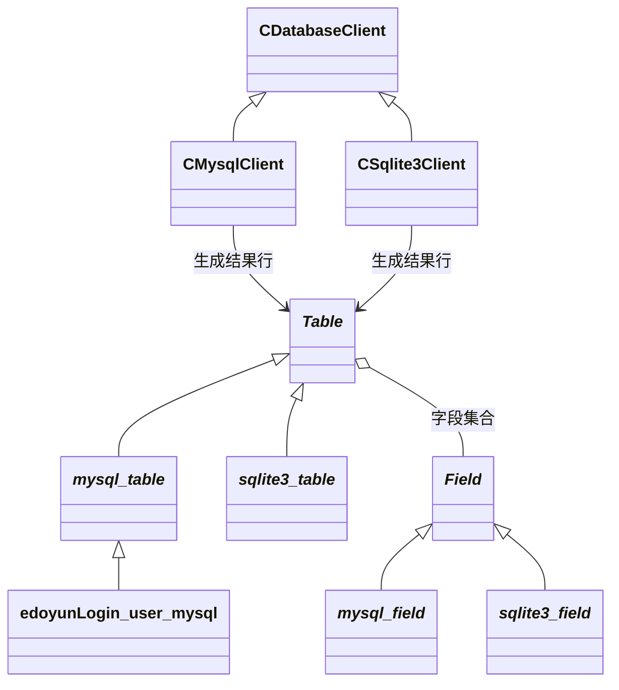

# EPlayerServer 阶段七 数据库接口与元数据

HTTP 提供了用户名等输入，数据库需要 SQL 和列值。项目没有直接把每条 SQL 写散到业务中，而是用表、字段和客户端三个层次组织。本章先解释数据模型，下一章再进入真实数据库调用。

源码入口：[DatabaseHelper.h](../inc/DatabaseHelper.h)、[MysqlClient.h](../inc/MysqlClient.h)、[MySQL 表字段实现](../src/MysqlClient.cpp)、[Sqlite3Client.h](../inc/Sqlite3Client.h)、[业务表定义](../inc/EdoyunPlayerServer.h)。

## 1. 从关系数据到对象

数据库表有列定义，每行保存一组值。SELECT 可以返回零行、一行或多行，UPDATE/DELETE 的 WHERE 决定目标集合，主键和唯一约束限制数据一致性。

本项目对应为：

```text
CDatabaseClient：连接与执行
_Table_：表名、字段定义、SQL 生成、行模板
_Field_：列名、类型、约束、本次操作标志、当前值
Result：若干独立的行对象
```

表对象并非自动连接数据库。`table.Create()` 只返回 SQL，`client.Exec(table.Create())` 才有真实执行。

元数据是“描述数据的数据”。例如 user_name 的列名、TEXT 类型、非空约束描述这列的结构；alice 则是某一行保存的具体值。表结构的整体描述常称为 schema，不能把它与某个用户当前的行值混为一谈。

## 2. 客户端接口和重载

| 接口 | 输入与输出 | 责任 |
| --- | --- | --- |
| Connect(args) | 字符串键值参数 | 建立后端连接 |
| Exec(sql) | SQL，int 结果 | 执行不取行的操作 |
| Exec(sql, result, table) | SQL、输出容器、行模板 | 执行并映射每行 |
| Start/Commit/RollbackTransaction | 无业务参数 | 控制同一连接的事务 |
| Close/IsConnected | 连接状态 | 释放或查询包装层状态 |

两个 Exec 在编译时按参数选择，不是在运行时自动判断调用者要不要结果。第三个参数 table 是行布局模板，不是“数据库连接要切到哪张表”。

## 3. 抽象和具体类的关系



客户端统一执行形状；具体表和字段承担方言与值转换。登录仍直接持有 CMysqlClient，并使用其独有 Escape，因此业务还没有仅依赖 CDatabaseClient。

## 4. 一个表对象的两种索引

```text
FieldDefine = [field_id, field_name, field_password, ...]
Fields      = {"user_id": field_id,
               "user_name": field_name,
               "user_password": field_password, ...}
```

vector 按顺序生成列列表，map 按名字定位结果。二者存的 shared_ptr 指向同一字段对象，不是两份各自独立的列值。

| 表成员 | 用途 |
| --- | --- |
| Database | 可选的 SQL 数据库限定名 |
| Name | 表名 |
| FieldDefine | 定义顺序与字段枚举 |
| Fields | 名称到字段的映射 |

Database 为空时使用未限定表名，MySQL 实际所在库由连接参数 db 决定；这两处配置不会自动互相复制。

## 5. 字段中结构与值同时存在

| 成员 | 属于哪一层 | 示例 |
| --- | --- | --- |
| Name | 列元数据 | user_password |
| Type、Size | SQL 表示 | VARCHAR 与 (15) |
| Attr | 建表约束位 | NOT_NULL、PRIMARY_KEY |
| Default、Check | SQL 表达式文字 | CURRENT_TIMESTAMP |
| Condition | 本次增删改选择位 | SQL_INSERT、SQL_MODIFY |
| nType | C++ 值的类型标签 | TYPE_TEXT、TYPE_INT |
| Value | 当前值 | Integer、Double、String 指针 |

表模板和行对象共用这种类型，因此一份对象可以用于定义 schema、提供写入值或保存查询结果。角色取决于使用阶段，不是每个角色都有独立类。

把登录实际使用的 user_name 放进这个模型：

```text
构造表模板：Name="user_name"，Type="TEXT"，nType=TYPE_TEXT
             Attr 带 NOT_NULL，Value.String 指向一个 Buffer
生成 Query：使用列名等元数据，拼出 SELECT 列列表
映射一行：  Copy 保留结构，再把数据库返回的 "alice" 写入该行 Buffer
读取字段：  Fields.at("user_name") 与 FieldDefine 对应项仍指向同一字段
```

因此元数据与值虽然装在同一个字段对象里，参与的是不同步骤。查询不会自动把模板当前的 user_name 值用作筛选条件，WHERE 仍由 Query 的参数提供。

## 6. 三组标志不能混用

### 6.1 Attr 是结构约束

NOT_NULL、DEFAULT、UNIQUE、PRIMARY_KEY、CHECK、AUTOINCREMENT 可以按位或组合。它们决定 CREATE TABLE 中的列定义或索引，不决定本次是否插入该列。

### 6.2 Condition 是操作选择

SQL_INSERT=1、SQL_MODIFY=2、SQL_CONDITION=4。Insert 选插入列，Modify 选 SET 和 WHERE，Delete 选 WHERE。ClearFieldUsed 只清 Condition，不清 Value，也不改变 Attr。

### 6.3 nType 是单值标签

nType 虽然也采用若干二进制幂数值，却供 switch 选择一种解释方式，不能组合 TYPE_INT 与 TYPE_TEXT。否则无法确定应该读取哪个 union 成员，析构也无法正确决定是否释放 String。

## 7. union 如何保存不同类型

```cpp
union
{
    bool Bool;
    int Integer;
    double Double;
    Buffer* String;
} Value{};
```

union 成员共用存储。文本、VARCHAR、BLOB 对应的具体字段构造会 new Buffer，析构负责 delete；数值直接放 union。当前加载代码对 BOOL/INT/DATETIME 都使用 Integer 分支。

手工标签设计必须让 nType 与实际有效成员保持一致。SQL NULL、数字 0 和空字符串是不同数据库值，当前模型没有为所有普通类型额外保存“这一行为空”的独立标志。

Default 也不自动成为 Value：它是生成 DDL 时的 SQL 表达式，不是构造函数给行值赋默认的 C++ 语句。

## 8. 业务表宏到底生成什么

业务头文件用 DECLARE_TABLE_CLASS、DECLARE_MYSQL_FIELD 和结束宏声明字段。结束宏的现有拼写为 DECLARE_TABLE_CLASS_EDN。

展开逻辑为：

```text
声明派生表类
  → 生成 Copy：new 这个派生类的副本
  → 构造函数设置 Name 为类名文字
  → 每条字段宏创建一个 _mysql_field_
  → 同一个 PField 同时加入 vector 与 map
```

宏中的 `#name` 把标识符转成字符串。编译器没有为每列自动生成同名成员变量；`Fields.at("user_password")` 仍然是运行时 map 查找。

这是一种减少重复代码的声明方式。字段集合在构造函数执行时建立，按名字取值仍走容器查找；宏本身没有增加运行时类型发现能力。

## 9. 建表 SQL 的生成

```cpp
Buffer _mysql_table_::Create()
{  //CREATE TABLE IF NOT EXISTS 表全名 (列定义,..., PRIMARY KEY `主键列名` ,UNIQUE INDEX `列名_UNIQUE` (列名 ASC) VISIBLE );
    Buffer sql = "CREATE TABLE IF NOT EXISTS " + (Buffer) * this + " (\r\n";
    for (unsigned i = 0; i < FieldDefine.size(); i++)
    {
        if (i > 0)
            sql += ",\r\n";
        sql += FieldDefine[i]->Create();
        if (FieldDefine[i]->Attr & PRIMARY_KEY)
        {
            sql += ",\r\n PRIMARY KEY (`" + FieldDefine[i]->Name + "`)";
        }
        if (FieldDefine[i]->Attr & UNIQUE)
        {
            sql += ",\r\n UNIQUE INDEX `" + FieldDefine[i]->Name + "_UNIQUE` (";
            sql += (Buffer)*FieldDefine[i] + " ASC) VISIBLE ";
        }
    }
    sql += ");";
    return sql;
}
```

Create 遍历字段，调用字段 Create；主键和唯一索引由表级逻辑补充。具体字段处理类型、长度、非空、自增和部分默认值。

`IF NOT EXISTS` 的意义是缺失时建表，不会比较旧表结构、补列或迁移数据。因此启动成功不等于 schema 已按最新定义升级。

MySQL 生成器未生成 CHECK；源码旧注释不能当作 MySQL 8 不支持 CHECK 的结论。MySQL 从 8.0.16 执行 CHECK 约束，见 [官方文档](https://dev.mysql.com/doc/refman/8.0/en/create-table-check-constraints.html)。

## 10. Insert 的两遍字段选择

```cpp
Buffer _mysql_table_::Insert(_Table_ const& values)
{  // INSERT INTO 表全名 (列名,...)VALUES(值,...);
    Buffer sql = "INSERT INTO " + (Buffer) * this + " (";
    bool isfirst = true;
    for (size_t i = 0; i < values.FieldDefine.size(); i++)
    {
        if (values.FieldDefine[i]->Condition & SQL_INSERT)
        {
            if (!isfirst)
                sql += ",";
            else
                isfirst = false;
            sql += (Buffer)*values.FieldDefine[i];
        }
    }
    sql += ") VALUES (";
    isfirst = true;
    for (size_t i = 0; i < values.FieldDefine.size(); i++)
    {
        if (values.FieldDefine[i]->Condition & SQL_INSERT)
        {
            if (!isfirst)
                sql += ",";
            else
                isfirst = false;
            sql += values.FieldDefine[i]->toSqlStr();
        }
    }
    sql += " );";
    printf("sql = %s\n", (char*)sql);
    return sql;
}
```

第一遍列出选中的列名，第二遍以同样顺序列出值。两遍都检查 SQL_INSERT，所以列和值应一一对应。

示意状态：

```text
id.Condition   = SQL_INSERT，id.Value=1
name.Condition = SQL_INSERT，name.Value="alice"
age.Condition  = 0

生成列列表：(id, name)
生成值列表：(1, alice 的 SQL 字面量)
```

值的 C++ 字符串与 SQL 字面量不同：后者必须有引号或后端规定的编码形式，交给 toSqlStr，而不是直接原样插入。

## 11. Modify、Delete 与 Query 的差异

| 方法 | SET 或值 | WHERE 来源 |
| --- | --- | --- |
| Insert | SQL_INSERT 列 | 无 |
| Modify | SQL_MODIFY 列 | SQL_CONDITION 列，等式按 AND 组合 |
| Delete | 无 | SQL_CONDITION 列 |
| Query | 默认枚举所有列 | 直接传入 condition 字符串 |

```cpp
Buffer _mysql_table_::Query(Buffer const& condition)
{
    Buffer sql = "SELECT ";
    for (size_t i = 0; i < FieldDefine.size(); i++)
    {
        if (i > 0)
            sql += ',';
        sql += '`' + FieldDefine[i]->Name + "` ";
    }
    sql += " FROM " + (Buffer) * this + " ";
    if (condition.size() > 0)
    {
        sql += " WHERE " + condition;
    }
    sql += ";";
    printf("sql = %s\n", (char*)sql);
    return sql;
}
```

Query 不读取字段的 SQL_CONDITION。注释“条件列”不能替代这个实际接口。调用传的是不含 WHERE 的条件表达式，方法负责加关键字。

没有 WHERE 的有效 UPDATE/DELETE 可以影响全表，主键存在不代表框架自动补主键条件。相同字段若同时用于 SET 和 WHERE，当前对象也只有一份值，不能自动表示“按旧值筛选、写新值”的两种不同值。

复杂比较、OR、JOIN 和按需列选择没有被这组标志完整建模；Query 的字符串条件能表达更多，但调用方承担其正确性与来源约束。

## 12. 标识符、文字值与方言

MySQL 标识符使用反引号，SQLite 使用双引号。文本值、数值、NULL 与 BLOB 再各自序列化，不能把列名引用和用户值转义混为一种操作。

MySQL 文本值当前生成 `CONVERT(X'十六进制' USING utf8mb4)`，BLOB 为 X 字面量；SQLite 文本把单引号翻倍，BLOB 也使用 X 字面量。

字段 toEqualExp 可为 TYPE_NULL 生成 IS NULL，但 Delete/Modify 当前直接拼等号与 toSqlStr，并未调用它。因此某个辅助函数具备能力，不表示所有上层路径都已使用这项能力。

## 13. 为什么结果接口需要 Copy

执行器只拿到 `_Table_` const&，不知道具体业务类，却要为每行创建正确字段对象。table.Copy 把创建责任委托给动态类型。

```cpp
PTable _mysql_table_::Copy() const
{
    return PTable(new _mysql_table_(*this));
}
```

业务表宏覆盖同名虚函数，创建具体业务表副本；若新派生类没有覆盖，只继承这里的 Copy，就只会创建 `_mysql_table_`，不会自动保留更下层类型。

这是 Prototype 式克隆的核心：从现有模板复制配置和动态行为，而不是执行器列出所有可能业务表并逐个 new。

## 14. 深拷贝保持每行独立

```cpp
_mysql_table_::_mysql_table_(_mysql_table_ const& table)
{
    Database = table.Database;
    Name = table.Name;
    for (size_t i = 0; i < table.FieldDefine.size(); i++)
    {
        PField field = PField(new _mysql_field_(*(_mysql_field_*)table.FieldDefine[i].get()));
        FieldDefine.push_back(field);
        Fields[field->Name] = field;
    }
}
```

```cpp
_mysql_field_::_mysql_field_(_mysql_field_ const& field) : _Field_()
{
    nType = field.nType;
    Value = field.Value;
    Condition = field.Condition;
    switch (field.nType)
    {
        case TYPE_VARCHAR:
        case TYPE_TEXT:
        case TYPE_BLOB:
            Value.String = new Buffer();
            *Value.String = *field.Value.String;
            break;
    }

    Name = field.Name;
    Attr = field.Attr;
    Type = field.Type;
    Size = field.Size;
    Default = field.Default;
    Check = field.Check;
}
```

```text
同一行内部：FieldDefine 与 Fields 共享同一个字段。
不同行之间：各自创建字段，字符串再创建独立 Buffer。
```

若两行只复制 shared_ptr，读第二行会覆盖第一行的值；若字段只复制 String 指针，又会共享内存并可能重复删除。

当前深拷贝来自具体拷贝构造，不代表所有赋值安全。`_Field_` 基类赋值直接复制 union，String 仍是浅复制。具体表拷贝还假定字段属于相同后端，不能任意混入另一种具体字段。

## 15. 行模型与完整 ORM 的区别

这里有 SQL 生成和结果映射，但没有完整的参数绑定、关系映射、变更追踪、迁移和 NULL/日期类型系统。表对象自己不执行 SQL，所以也不是典型 Active Record；接口表达 SQL 与字段，不是领域用户集合式 Repository。

本章得到的关键中间产物是：一段 SQL、一份字段布局模板、一个待填行容器。下一章解释数据库客户端怎样把它们变成实际结果。

[返回路线](README.md) · [上一章 HTTP 与连接状态](06-HTTP解析与连接状态.md) · [下一章 执行与映射](08-数据库执行与结果映射.md)
