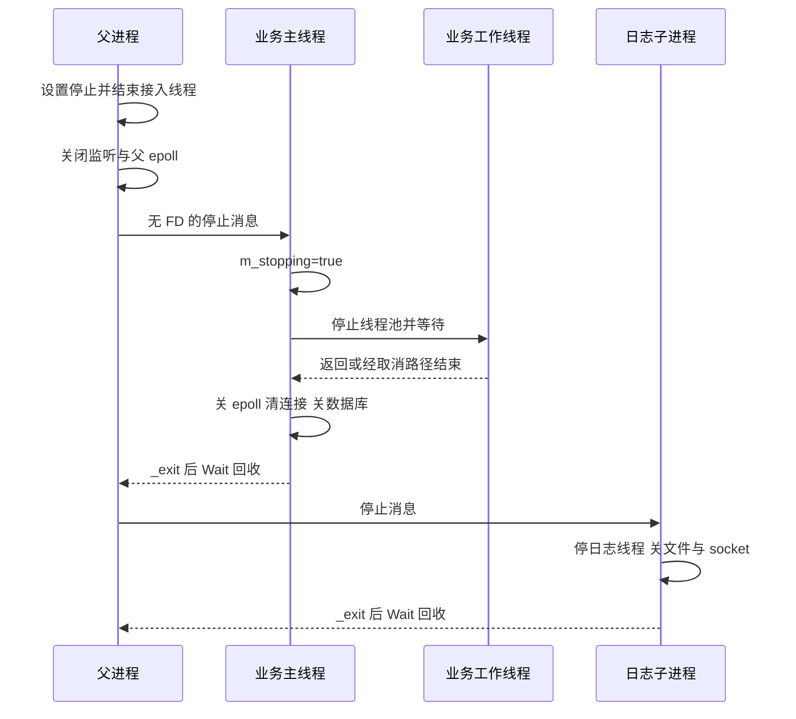

# EPlayerServer 阶段十 启动停机与资源生命周期

前面的请求路径以设施已经可用为前提。本章补上两端：资源按什么顺序取得，失败怎样传播，以及谁负责先结束使用者再释放资源。

源码入口：[main.cpp](../src/main.cpp)、[CServer.cpp](../src/CServer.cpp)、[BusinessProcess](../src/EdoyunPlayerServer.cpp)、[Process.h](../inc/Process.h)、[Thread.h](../inc/Thread.h)、[Logger.h](../inc/Logger.h)。

## 1. 必须分开的四种寿命

| 寿命 | 起点 | 终点 |
| --- | --- | --- |
| 连接的逻辑登记 | map 插入与 epoll Add | RemoveClient |
| socket 包装与 FD | 创建或接管有效 FD | 最后拥有者释放并 Close |
| 工作线程 | pthread_create | 入口返回或取消，随后 join |
| 子进程 | fork | _exit/信号结束，父进程 wait 回收 |

删除一个 map 元素，不等于正在处理它的线程已结束；关闭一个 FD，不等于子进程已回收；对象有析构，也不表示所有退出方式都会调用析构。

## 2. main 中的装配顺序

main 的分支围绕三件事组织：创建前验证输入，启动时等待依赖就绪，退出时按依赖顺序收尾。先看正常路径，参数解析的完整代码见 [main.cpp](../src/main.cpp)。

```text
参数解析和 IPv4 校验
  → 启动日志子进程，等待就绪
  → 构造 business，再构造 server
  → server.Init，等待业务并建立接入设施
  → 安装父进程停止信号处理，进入 server.Run
  → Run 返回后 server.Close
  → 通知日志停止并 Wait
  → main 返回，局部对象反向析构
```

其中业务对象的来源和借用关系，在这三行源码里确定：

```cpp
CEdoyunPlayerServer business(workers);
CServer server;
int result = server.Init(&business, host, static_cast<short>(port));
```

日志启动失败时 main 清理并返回 1；server.Init 失败时也会执行 server.Close 和日志停止流程。信号处理及 Run 只在 Init 成功后进入。这样的分支安排使“还没开始服务”与“正在服务后收到停止”有不同入口，但共享必要的收尾动作。

### 2.1 参数阶段

默认监听 0.0.0.0:9999，workers=4。Number 使用 stoul 并检查全部文字被消费，端口允许 1..65535，workers 允许 1..128；host 要通过 IPv4 校验。--help 在创建日志和数据库之前结束。

### 2.2 创建顺序影响析构顺序

main 先构造 logProcess，再 business，再 server。父进程正常返回时反向析构，因此 server 先于 business；它借用的业务指针在关闭期间仍有效。

显式 server.Close 和之后析构中的 Close 在常规路径上会重复调用，所以包装用 nullptr、-1 和空容器等状态避免再次释放同一资源。但这不等于支持任意并发 Close 或完整重启。

## 3. 日志子入口的局部对象

```cpp
int LogProcess(CProcess* process)
{
    CLoggerServer logger;
    int result = logger.Start();
    process->NotifyReady(result);
    if (result != 0)
        return result;
    int descriptor = -1;
    process->RecvFD(descriptor);
    if (descriptor >= 0)
        close(descriptor);
    logger.Close();
    return 0;
}
```

logger 是 LogProcess 内的局部对象。正常返回前显式 Close，随后离开此函数作用域也会析构；这与外层 main 中的 business 不同。

logger.Start 返回后立即通知父进程：0 报告就绪，非零报告初始化失败。失败时本函数随即返回；成功时主线程等待控制消息，日志工作线程接收文本。控制消息和日志内容通过不同通道传输。

## 4. CServer::Init 的依赖顺序

```cpp
int CServer::Init(CBusiness* business, Buffer const& ip, short port)
{
    if (!business || m_server)
        return -1;
    m_business = business;
    m_stop = 0;
    if (m_process.SetEntryFunction(&CBusiness::BusinessProcess, business, &m_process) != 0 ||
        m_process.CreateSubProcess() != 0)
        return -2;
    if (m_process.WaitReady() != 0)
    {
        Close();
        return -3;
    }
    m_server = new CSocket();
    if (m_server->Init(CSockParam(
            ip, port, SOCK_ISSERVER | SOCK_ISIP | SOCK_ISREUSE | SOCK_ISNONBLOCK)) != 0 ||
        m_epoll.Create(2) != 0 || m_epoll.Add(*m_server, EpollData(m_server)) != 0 ||
        m_pool.Start(2) != 0)
    {
        Close();
        return -4;
    }
    for (size_t i = 0; i < m_pool.Size(); ++i)
    {
        if (m_pool.AddTask(&CServer::ThreadFunc, this) != 0)
        {
            Close();
            return -5;
        }
    }
    return 0;
}
```

| 资源阶段 | 为什么在这里 |
| --- | --- |
| 检查 business 与已有监听 | 排除无入口或重复初始化 |
| 绑定并 fork 业务入口 | 在父接入线程建立前完成分支 |
| WaitReady | 先确认业务初始化结果 |
| 创建监听、epoll、线程池 | 再向外提供接入能力 |
| AddTask 两个事件循环 | 将已创建线程用于接入 |

业务就绪发生在父监听之前。数据库连接失败时，服务不会进入正常监听状态，不应期待浏览器收到业务 JSON 的 -3。

## 5. BusinessProcess 内部初始化与收尾

阶段六已展开工作线程怎样处理客户端，本节只看业务主线程的生命周期。完整入口见 [BusinessProcess](../src/EdoyunPlayerServer.cpp)。

| 阶段 | 按源码先后发生的动作 | 执行者 |
| --- | --- | --- |
| 初始化 | 读取数据库环境，Connect，再执行建表 SQL | 业务主线程 |
| 建立执行设施 | 注册回调、创建 epoll 和池、提交 N 个长期循环 | 业务主线程；工作线程开始等待事件 |
| 就绪 | NotifyReady(0) | 业务主线程向父进程报告 |
| 接收连接 | RecvSocket → 非阻塞包装 → 插入 map → Connected → epoll Add | 业务主线程 |
| 处理请求 | 等待客户端事件、读、解析、校验和响应 | 业务工作线程，详见阶段六至九 |
| 结束接收 | 收到无 FD 的停止消息，或控制接收失败 | 业务主线程跳出 RecvSocket 循环 |

跳出后，入口尾部执行以下收尾源码：

```cpp
m_stopping = true;
m_pool.Close();
m_epoll.Close();
m_mapClients.clear();
m_db->Close();
return 0;
```

先让长期循环结束并回收工作线程，才能释放它们使用的 epoll、连接状态与数据库。入口随后返回给 CProcess，再由 _exit 结束子进程。初始化早退没有经过这段尾部，具体影响在本章第十一节解释。

## 6. 资源取得与释放表

| 资源 | 取得者 | 正常释放路径 |
| --- | --- | --- |
| 日志文件 | 日志 Start | 日志 Close/fclose |
| 日志监听及客户端 | 日志服务与接收线程 | 停线程后清对象、关闭监听 |
| 业务 MySQL | BusinessProcess | 业务主循环结束后 Close |
| 父监听 | CServer::Init | 接入线程停止后 delete |
| 业务客户端 | 业务主线程 | RemoveClient 后最后状态引用释放 |
| epoll | 各服务 Init | 各自工作线程结束后 Close |
| pthread | CThread::Start | Stop/join |
| 子 PID | CProcess::CreateSubProcess | CServer 或 main 显式 Wait |

CProcess 的通道描述符在对象析构或进程结束时关闭，Wait 本身主要回收子进程，不等价于立即销毁全部通道与入口对象。

## 7. 停止标志分三层

```text
CServer::m_stop / business::m_stopping / logger::m_running
  → 服务循环是否继续

CThreadPool::m_stopping
  → 取任务等待与退出条件

CThread::m_running
  → 线程包装状态，不自动控制任意用户函数
```

正常流程先建立服务停止事实，再回收线程。只调线程 Stop 而长期任务不检查对应服务条件，就只能依赖取消后备路径。

父进程使用 volatile sig_atomic_t，业务和日志使用 `atomic<bool>`。volatile 没有建立 C++ 工作线程之间的同步，这是当前实现的并发边界，不能因正常退出验证通过就忽略。

## 8. 主进程收到 Ctrl+C 之后

SIGINT/SIGTERM 在正常初始化完成后进入 StopServer，通过 activeServer 设置停止标志。Run 每轮休眠约 10 ms 并检查停止，返回后 main 执行显式关闭。

```text
信号进入父进程
  → RequestStop
  → Run 返回
  → server.Close
  → 回到 main
  → logProcess.SendFD(-1)
  → logProcess.Wait
```

子进程忽略 SIGINT，由正常控制协议退出；SIGTERM 后备则采用默认动作，不能等同为同一条完整清理路径。初始化各阶段尚未全部建立上述处理设施。

## 9. CServer::Close 的实际顺序

```cpp
int CServer::Close()
{
    m_stop = 1;
    m_pool.Close();
    if (m_server)
    {
        m_epoll.Del(*m_server);
        delete m_server;
        m_server = nullptr;
    }
    m_epoll.Close();
    m_process.SendSocket(-1, nullptr);
    m_process.Wait();
    return 0;
}
```

先停接入线程，避免它们再访问监听和发送连接；然后删监听登记、关闭监听与 epoll；随后通知业务停止并 Wait。

主进程是在业务进程已经回收之后，才执行日志的停止通知。不能画成“先停日志，最后一起回收全部子进程”，否则会误解关闭期间的日志可用窗口。

## 10. 正常停机时间线



这是一条协调关闭的正常路径，并没有严格保证所有已接入请求完成后才开始停止。

## 11. _exit 与 RAII 的边界

CProcess 在子入口返回后调用 _exit。这个动作回收进程内存并关闭剩余描述符，但不继续展开外层 C++ 栈，stdio 也不按正常 exit 自动刷新，见 [_exit 手册](https://man7.org/linux/man-pages/man2/_exit.2.html)。

| 对象 | 子入口正常返回时会怎样 |
| --- | --- |
| BusinessProcess 内的局部 table | 离开函数时析构 |
| LogProcess 内的局部 logger | 离开函数时析构 |
| main 中继承过来的 business | 外层栈不展开，不自动析构 |
| business.m_db 的 unique_ptr | 随外层对象未析构，不自动 delete |
| 父进程中的 business | 父 main 返回时析构自己的副本 |

父对象的析构不会跨进程调用子对象析构。正常业务数据库 Close 因此依赖入口末尾的显式调用，而不是父进程稍后的同名对象析构。

早期失败返回也要区分：例如数据库已连接但建表失败，入口未走到正常末尾清理；随后 _exit 的内核回收不等于 CMysqlClient::Close 被执行过。

## 12. 时间参数为何不是整体退出上限

CThread::Stop 等约 100 ms 后取消再 join，等待仍受取消点和任务行为影响。CProcess::Wait 轮询约三秒后 SIGTERM，再阻塞 waitpid；目标不退出时也没有第二段严格时限。

所以“配置了超时数值”与“整个关闭一定在此时间结束”不同。取消还可能在一项业务只完成部分步骤时发生，不提供事务式撤销。

## 13. 一次错误怎样跨层转换

以 MySQL 连接失败为例：

```text
mysql_real_connect 失败
  → CMysqlClient::Connect 返回自己的错误，例如 -3
  → BusinessProcess 映射为 -1
  → 未主动就绪时，CProcess 发送 NotifyReady(-1)
  → CServer::Init 将非零就绪结果映射为 -3
  → main 输出初始化失败并返回 1
```

业务子进程自身也以 1 退出；Wait 拿到编码状态，和 NotifyReady 携带的 int 并不是同一份结果。

请求期间的 SQL 错误才进入 JSON status=-3。异常路径又不同：Crypto 与普通内存分配可能抛异常，当前没有统一地转换成这些返回码。

## 14. 当前没有严格排空协议

“排空”指停止接受新工作之后，让已经接受的工作达到约定的完成条件，再释放设施。完成条件可能是所有响应字节都发送完，或日志记录都写入文件；必须先定义清楚，才能判断停机是否满足。

| 当前动作 | 尚不能推出的保证 |
| --- | --- |
| 停接入 | 所有已交付客户端都完成响应 |
| 池 Close | 所有已入队任务都完整执行 |
| 连接 Send 返回 | 客户端已解析并确认结果 |
| 日志 Close | 所有在途记录已持久化 |
| 就绪成功 | 事件循环后来不会失败退出 |

长期 ThreadFunc 若因 epoll 错误返回，线程池丢弃返回值并继续等待任务，不自动重新提交循环；父进程也不因此停止监听。PID 和线程仍存在，不等于服务处理能力持续正常。

## 15. 调试位置必须跨对进程

默认 VS Code 跟随父进程，因此 CServer 接入断点能命中，登录方法却在另一个进程。第一次 fork 是日志，第二次才是业务；需跟随后者或附加实际业务 PID。

就绪前长时间停住会制造父进程五秒超时。适合观察请求的断点是已经就绪之后的业务 ThreadFunc、Received、HttpParser，以及发送和 RemoveClient。参见 [GDB fork 调试说明](https://sourceware.org/gdb/current/onlinedocs/gdb.html/Forks.html)。

下一章在这些真实生命周期之上分析模式，区分当前已实现的协作与可演进但尚不存在的结构。

[返回路线](README.md) · [上一章 登录与响应](09-登录校验与响应封装.md) · [下一章 架构与设计模式](11-架构设计模式与演进.md)
