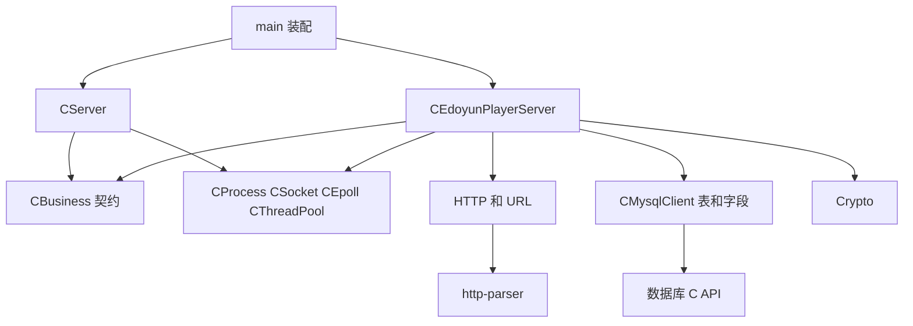
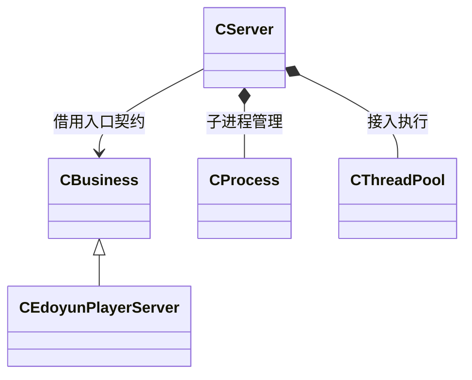

# EPlayerServer 阶段十一 架构设计模式与演进

本章把已经追踪过的执行过程转成设计判断：哪些变化被接口挡住，哪些资源形成串行点，模式如何组织参与者，又有哪些能力仍未实现。

模式名称是根据当前源码职责作的分析，不是源码作者逐类声明的标签。判断依据是参与者、协作和变化边界，而不是看到 static、virtual 或 new 就套名称。

## 1. 架构首先是三种边界

### 1.1 执行边界

父进程接入，业务进程处理，日志进程写文件。每次连接不再 fork，也没有一组按连接创建的业务子进程池。

```text
两个父接入线程
  → 同一条父子连接通道
  → 一个业务主线程接收 FD
  → N 个业务事件线程共享同一个业务 epoll
  → 一条受锁保护的 MySQL 连接
```

线程数、进程数、epoll 数和数据库连接数是四个独立数量。增加 workers 只改变其中一个，不会自动改其余三个。

从当前职责分布，可以看到进程拆分带来的取舍：

| 拆分 | 得到的组织效果 | 必须支付的成本 |
| --- | --- | --- |
| 接入与业务分开 | 父进程围绕监听和转交组织；业务在自己的地址空间维护解析、数据库与规则 | 新连接需要传 FD，启动需要等待业务就绪，关闭需要跨进程协调 |
| 日志独立 | 各产生线程只提交文本，由日志进程集中管理文件 | 多一条通信链路，需要处理记录边界、缓冲和停止时机 |

独立地址空间限制了普通内存被直接互相修改，依赖仍通过通道保留。例如业务不再接收 FD 时，父进程转交最终仍可能阻塞；日志接收变慢也可能拖住生产端。进程拆分改变了状态归属，同时引入通信协议，并未消除上下游关系。

### 1.2 契约边界

CServer 通过 CBusiness 进入具体服务，数据库客户端用共同接口适配 C API。HTTP、存储和规则在 CEdoyunPlayerServer 内部仍直接协作，未隔离成纯领域层。

### 1.3 生命周期边界

FD、包装对象、连接状态、线程和进程有不同结束时刻。阶段十说明了关闭顺序，这些规则也是架构的一部分，不只是工具类内部细节。

## 2. 静态依赖与运行关系



箭头表示使用或接口依赖，不是全部拥有关系。CServer 借用业务对象，拥有自己的 CProcess、epoll 和池；业务对象在子进程建立客户端和数据库资源。

CBusiness 实际定义在 CServer.h 中，所以逻辑上有契约，不代表物理上已分成最小独立接口头文件或可加载插件包。CMake 的 core 也统一收集多数实现，未按每个领域边界拆成独立库。

## 3. 模式的尺度与源码落点

| 设计 | 解决的问题 | 当前落点 |
| --- | --- | --- |
| Reactor（反应器） | 多连接就绪与处理分发 | epoll 加 ThreadFunc |
| 生产者消费者 | 任务提交与执行协调 | 线程池队列、锁、条件变量 |
| Command（命令） | 把调用保存并延后执行 | CFunction 与 CFunctionBase |
| Adapter（适配器） | 对齐不同 API 的契约 | MySQL/SQLite 客户端与 C 回调包装 |
| Prototype（原型） | 不知道具体类型仍可复制结果模板 | `_Table_`::Copy 与派生表 |
| Strategy（策略）思路 | 把变化行为交给可替换对象 | CServer 使用 CBusiness |
| Facade（外观）思路 | 为装配入口汇总子系统操作 | CServer::Init/Run/Close |
| RAII 与所有权 | 明确释放责任 | 锁、智能指针、FD 包装 |
| 依赖注入、控制反转 | 分开对象来源与调用时机 | Init 参数与事件回调 |

进程划分属于运行架构，Reactor 属于事件组织，Command 等属于对象协作，RAII 属于 C++ 资源惯用法。它们不在同一个层级，也不互相替代。

首次阅读优先掌握 Reactor、Command、Adapter、Prototype 这四种模式，它们都有直接可追踪的协作链。Reactor 决定何时处理 FD；Command 让线程池能保存不同调用；Adapter 翻译外部接口；Prototype 决定怎样生成独立结果行。Strategy、Facade 和注入再帮助解释整体装配。

## 4. Reactor 的参与者和推导

### 4.1 原始问题

线程不能对每条空闲连接持续阻塞读取，也不应不停轮询全部 FD。需要一个共享等待机制返回可推进的连接，再由应用分发。

### 4.2 参与者映射

| 角色 | 本项目 |
| --- | --- |
| 句柄 | 监听和客户端 FD |
| 就绪多路分离 | CEpoll::WaitEvents / epoll_wait |
| 登记管理 | Add、Modify、Del |
| 分发者 | ThreadFunc 的循环与事件分支 |
| 处理器 | accept 转交、读取解析、日志接收写入 |

当前没有独立通用 EventHandler 继承树，处理器职责直接写在循环中，但等待、分发和处理的组织关系仍可识别为 Reactor。原始职责可对照 [Reactor 论文](https://www.dre.vanderbilt.edu/~schmidt/PDF/reactor-siemens.pdf)。

### 4.3 为什么不是 Proactor

当前通知的是就绪，read 在处理线程里执行。没有预先提交含用户缓冲与操作对象的异步读取，再取得完成结果的链路。线程池的存在不改变这一事实。

当前业务 N 个线程共同等待一个 epoll，ONESHOT 协调同一登记处理；也不是每条线程各有独立子 Reactor 的结构。

### 4.4 成本与边界

同步 SQL 发生在事件处理线程里。假设 N=2，线程 A 执行慢查询，线程 B 等同一数据库锁，即使更多连接已就绪，也可能没有空闲工作线程推进。

Reactor 隔离等待，不自动隔离耗时业务。真正把查询调度到另一执行单元，还需定义请求状态、任务结果回传、连接关闭后的旧结果处理；当前没有实现这套异步协议。

## 5. Command 与类型擦除

### 5.1 问题与角色

池需要保存不知道具体类型的工作，而不认识每个接收业务类。

| 角色 | 对应对象 |
| --- | --- |
| 命令接口 | CFunctionBase 的无参 operator() |
| 具体命令 | `CFunction<Function, Args...>` |
| 动作与接收者 | 绑定函数、this 与其他参数 |
| 调用者 | TaskDispatch |
| 所有者 | 队列或当前线程的 unique_ptr |

### 5.2 一次任务如何执行

```text
AddTask(&CServer::ThreadFunc, this)
  → 生成带具体类型的 CFunction
  → 以基类 unique_ptr 入队
  → worker 取出
  → 虚 operator()
  → binder 调用指定对象的 ThreadFunc
```

模板负责接收类型，虚接口负责统一执行，组合成类型擦除。任务类型仍存在于对象内部，只是池不需要知道。

### 5.3 能力没有自动扩展

这是 Command 的轻量任务应用，不要求必须有撤销，但当前也没有返回 future、取消令牌、任务优先级或结果历史。

保存 this 不拥有接收者；命令对象还活着不能证明其接收对象还有效。当前生命周期依靠服务先停执行者再析构的安排。

## 6. Adapter 怎样隔离 C API

| 角色 | 数据库映射 |
| --- | --- |
| 调用者期望接口 | CDatabaseClient |
| 适配者 | CMysqlClient、CSqlite3Client |
| 原有能力 | mysql_*、sqlite3_* API |
| 翻译内容 | 参数、错误码、结果句柄、行和列 |

具体客户端继承期望接口，同时在内部保存底层句柄并调用 C API。“继承接口”和“组合原有能力”同时存在，不矛盾。

CHttpParser 也包装 C 库，通过静态函数和 data=this 把 C 回调转成实例方法。这是调用形式与状态归属的适配，不等于创建了一个通用协议插件系统。

共同 Connect/Exec 名称仍有参数和方言差异。调用者若继续传 MySQL SQL、使用 Escape 与 `_mysql_table_`，仅把变量声明成 CDatabaseClient* 并不能完成后端替换。

## 7. Prototype 为什么对应 Copy

执行器只知道 `_Table_`，却需要为每行创建正确结构。若它直接 new 每种具体业务表，就会反向依赖全部业务类型。

```text
调用者提供表原型
  → 执行器虚调用 Copy
  → 具体表克隆自己的类型和字段
  → 为该行填值
```

Copy 的核心意图是复制既有布局与配置，所以按 Prototype 分析最直接。它也使用虚创建方法，但不能仅凭这一机制忽略克隆目的而只贴 Factory Method。

### 7.1 独立性有两层

同一行的 vector/map 指向同一字段，跨行的字段和文本 Buffer 则必须独立。阶段七的具体拷贝构造完成后者，基类浅赋值并不提供相同保证。

### 7.2 保留动态类型有前提

每个具体派生表需要覆盖 Copy；继承基类 Copy 只能创建该基类。宏生成覆盖负责当前业务表的这一条件。

### 7.3 设计代价

每行复制 schema 与字段对象，带来分配和元数据重复。若未来分离只读表描述与行值，可让多行共享描述、独占值；这是新的模型设计，当前尚未实现。

## 8. Strategy 思路的准确范围

CServer 是使用上下文，CBusiness::BusinessProcess 是契约，CEdoyunPlayerServer 是具体服务，main 是选择与装配者。



当前替换的是整个业务子进程入口，包含生命周期、连接处理和具体规则，因此称为粗粒度 Strategy 思路。不能由它推断已把 MD5 登录规则独立成算法策略族。

策略本身不要求运行中热切换，也不要求先写很多派生类才有可替换边界。这里未提供热切换的事实，来自“选择在 fork 前，子进程运行副本，控制协议没有重配置消息”。

新增另一种 CBusiness 并在 main 选择它，可以复用接入；只想新增一个登录参数，则不必为每个小变化新建整个服务类。

## 9. 依赖注入与控制反转

依赖注入回答“具体依赖从哪里来”：main 创建业务，Init 参数传入，CServer 不 new 写死的 CEdoyunPlayerServer。

控制反转回答“谁掌握调用时刻”：方法被登记为回调，由事件流程在连接或请求达到条件后触发。当前登记和事件驱动都在具体业务类，CBusiness 只提供回调存储，父进程 CServer 不驱动 HTTP 回调。

两者都不需要容器。依赖倒置再关注依赖方向：接入层使用抽象业务契约；登录对具体 MySQL 和字段表示仍存在依赖。

## 10. Facade 与生命周期编排

main 通过 Init、Run、Close 使用监听、epoll、线程池和业务进程，接口汇总具有 Facade 效果。但 CServer 的主要责任还是组织启动依赖与关闭顺序。

方法少不是判定外观的充分条件，外观也不要求无状态。这里应同时看到“调用方被简化”和“内部资源阶段必须协调”。

初始化中途失败后再 Close，就是这种编排必须面对的状态；它不是只把几个子系统函数原样转发即可完成。

## 11. RAII 的责任与进程边界

lock_guard、unique_ptr 和 epoll 包装让释放责任跟随对象。借用业务指针和 epoll 中的裸 ptr 不增加所有权，shared_ptr 则明确延长连接状态寿命。

RAII 以析构实际执行为前提，_exit 会跳过外层 business 的析构。因此正常业务入口仍显式关数据库与池；父进程中同名副本的析构不能替代子进程清理。原则可对照 [C++ Core Guidelines R.1](https://isocpp.github.io/CppCoreGuidelines/CppCoreGuidelines#Rr-raii)。

流式 LogInfo 在析构时提交记录，是寿命驱动副作用；它并不因此拥有日志文件，也不自动成为 Builder。

进程、线程和 epoll 包装明确禁止复制，socket 包装却没有同样统一的限制。若按值复制一个独占 FD 的包装，两个对象可能都认为自己应 close 同一个数字；不能从某几个类的 RAII 实现，推导所有资源类都已经具备正确复制语义。

## 12. 不按表面形状贴模式名称

这一节用于回查命名，不是理解请求流程的前置知识。判断一个模式，先说清它解决的问题和对象间协作，再观察语法形状。

| 表面代码 | 容易误认 | 当前实际情况 |
| --- | --- | --- |
| static Trace | Singleton | 每线程客户端，服务实例可正常构造，没有全局唯一实例约束 |
| 单个回调槽 | Observer | 没有当前实现中的订阅集合与广播退订组织 |
| BusinessProcess 虚函数 | Template Method | 基类没有实现逐步调用虚钩子的骨架算法 |
| 字段宏中的 new | Factory Method | 宏是代码生成，Copy 的意图是已有对象克隆 |
| 连续 operator<< | Builder | 主要是文本追加和析构提交 |
| 状态整数或 complete | State | 状态数据驱动分支，未拆为多态状态对象 |
| 两种数据库继承树 | Bridge | 主要适配后端，没有独立抽象对象组合实现者的双维变化 |

模式可重叠，但每一次命名都要解释特定意图，不能把一个语法词当成整个架构的证明。

## 13. 理解代码需要的不变量

不变量是各次处理之间应保持的条件，帮助解释代码组织，不代表当前实现已对所有异常路径完成证明。

| 条件 | 当前落点 |
| --- | --- |
| 不遍历无效事件 | 仅处理 WaitEvents 返回 count 范围 |
| 执行任务时不持队列锁 | TaskDispatch 的内层作用域 |
| 事件查到前先有连接状态 | 插入 map 后再 epoll Add |
| 重启登记前先完成本轮更新 | 未完整分支最后 Modify |
| 不同行不共享可变字段值 | 表与字段深拷贝 |
| 结束使用者后释放设施 | 服务停止、池回收、epoll 和连接清理顺序 |
| 每个拥有的 FD 不重复 close | Close 置 -1、指针置空等包装状态 |

shared_ptr 只保证活着，ONESHOT 只协调登记，数据库锁只保护共享连接。不能把一项不变量的机制拿去证明另一项。

## 14. 性能和背压来自资源模型

背压是下游处理能力不足时，上游的接收或生产也受到约束。例如日志进程来不及读取，内核发送缓冲逐渐占满，生产线程的阻塞 Send 就可能等待。这里可以观察到压力传播，但尚未形成有明确额度、准入和恢复条件的应用层调节协议。

共享 MySQL 是明显串行点。增加网络线程可能提高就绪处理机会，但查询容量仍由这条连接和锁决定。当前业务线程执行查询，慢查询会同时减少可用事件执行者。

父子 socketpair 与日志 socket 也有有限缓冲。下游跟不上时，阻塞可沿 SendSocket 或日志 Send 传回上游。当前没有显式有界任务准入、全局连接额度和完整慢连接超时策略。

网络长度上限只约束单连接累计字节，不是总内存上限；request 与 parser 字段、重复解析结果都占内存，连接数量还可累加。

输出侧没有跨事件发送状态，若未来加有序发送与背压，需要缓冲、偏移、容量和关闭边界共同建模，不能只加 EPOLLOUT 一个标志。

## 15. 与参考 IOCP 项目最重要的差别

当前 read/send 在调用返回前完成相应的同步内存访问，chunk 不需要为了下一次 epoll 事件继续存活；跨事件保存的是应用的请求语义状态。

参考讲义中的 Overlapped operation 则需要让内核异步操作引用的对象活到对应完成边界。不能把“关闭 socket 后还需排空 completion”的具体账本原样写成本项目已实现机制。

同样，当前 Send 返回后关闭连接，并不提供应用确认或严格排空。两种模型都需要清楚的生命周期，但具体需要保留的对象和收敛条件不同。

## 16. 设计原则怎样用于变化判断

单一职责看变化原因：CProcess 主要围绕进程协议，CEdoyunPlayerServer 同时随网络、HTTP、表、算法、响应而变化，职责较宽。

开闭原则看扩展传播：新增业务实现可以少动 CServer，换数据库却仍会触及 Escape、方言与字段访问。

里氏替换看共同契约：相同 Connect 形状不等于 host、SQL 与错误语义完全一致。接口隔离则提醒 CFunctionBase 的三种默认重载会将部分误用延后到运行期。

依赖倒置关注规则是否认识具体基础设施。当前接入已有业务契约，登录内部尚缺“按用户名取用户”的独立存储接口。

## 17. 演进方向与当前事实分开

下面按需求找变化位置，用来检验前述接口是否隔离了相应知识。它们是理解现有边界的辅助分析，可在掌握请求主线后再读。

| 需求变化 | 主要影响 | 当前已有的支点 |
| --- | --- | --- |
| 新独立业务服务 | 新 CBusiness 与入口装配 | 接入与业务入口分离 |
| 新登录路由 | 业务 HttpParser 与请求模型 | 已有完整请求边界 |
| 新摘要方案 | Crypto、业务协议、客户端 | 摘要能力集中 |
| 切换存储 | 客户端、方言、Escape、字段访问 | 已有数据库执行接口 |
| 非阻塞续写 | ClientState、可写事件、缓冲、关闭时机 | 已有每连接持久状态 |
| 严格请求排空 | 停止准入、在途计数、完成确认 | 已有正常关闭顺序 |
| 独立登录服务或仓储 | 新契约与数据对象 | 现有逻辑可据调用链拆分 |

这些是未来改造的影响分析，当前没有额外写入这些类或机制。讲义也不会把期望设计画成已经存在的代码。

## 18. 把全部模式重新放回一次请求

```text
main 注入具体业务
  → CServer 通过契约委托
  → CProcess 保存入口并 fork
  → 线程池执行命令对象中的长期循环
  → Reactor 等待并分发就绪
  → HTTP 适配得到字段
  → 数据库适配执行 SQL
  → Prototype 为结果创建独立行
  → 登录规则生成状态与响应
  → 连接所有权和服务关闭协议完成释放
```

真正的架构理解，是能把这条链上的对象、线程、字节、状态和失败出口对应回文件。模式解释其中为什么这样组织，源码决定当前究竟做到了哪一步。

[返回路线](README.md) · [上一章 启动与停机](10-启动停机与资源生命周期.md) · [回看整体请求](00-项目架构与请求主线.md)
